# SoloOS

**The operating system for a one-person software business.** Projects, tasks, time tracking, payments, a light CRM,
client conversations, project docs and a read-only client portal in one app, with Claude built in where it helps.

Single user. Runs locally for development and on Vercel + Neon in production. See [PLAN.md](PLAN.md) for scope and roadmap.

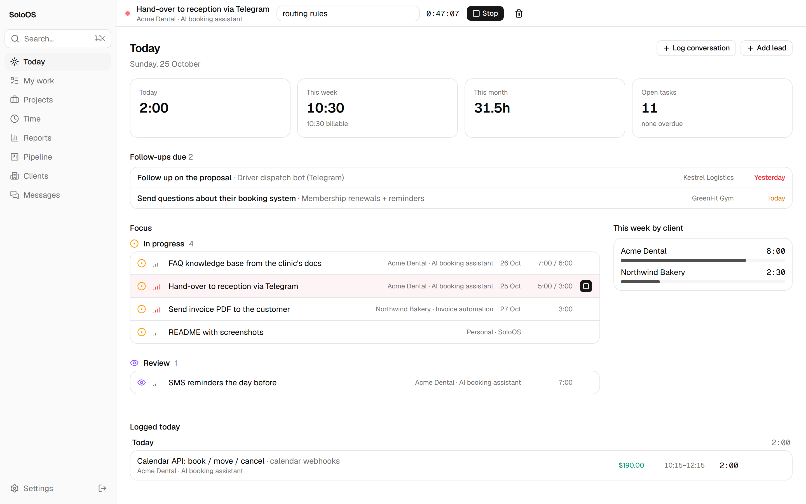

<sub>All screenshots use made-up demo data (`pnpm demo:seed`).</sub>

## What it does

### Work: tasks, timer, ⌘K

One timer for everything, always visible at the top. `⌘K` jumps anywhere, starts a timer on any task, logs time or
adds a task/lead without leaving the keyboard; `⌥S` stops or resumes the timer.

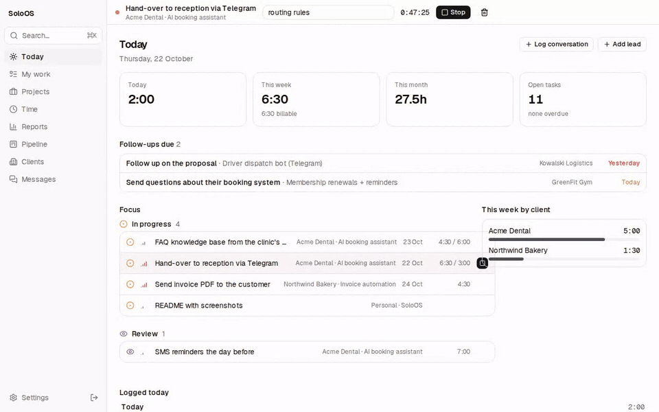

Each project has a drag-and-drop board (or a list), with tracked vs. estimated time on every card.

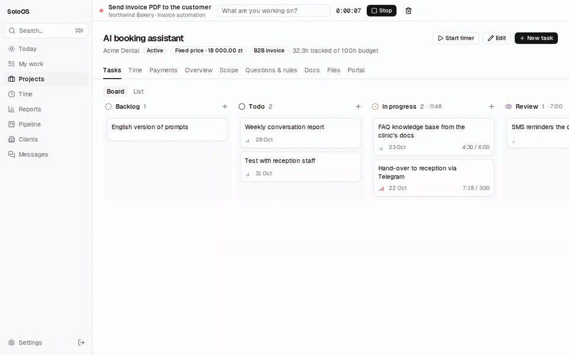

<table>
  <tr>
    <td>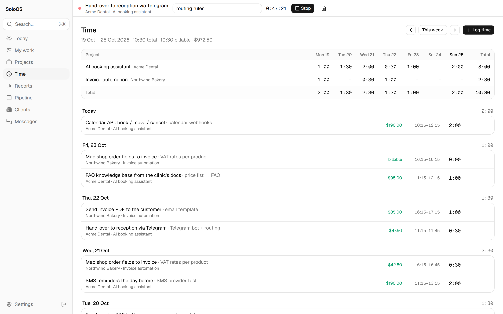</td>
    <td>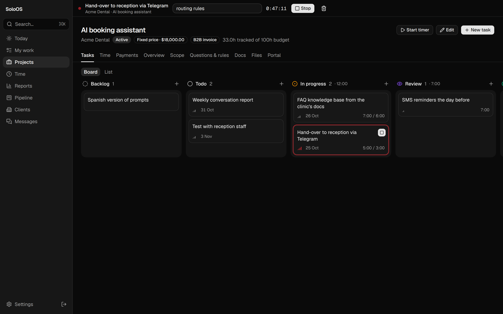</td>
  </tr>
  <tr>
    <td align="center"><sub>Week view and every entry with its value (rates are snapshotted per entry)</sub></td>
    <td align="center"><sub>Dark mode</sub></td>
  </tr>
</table>

### Money: fixed price, hourly, payments, reports

Fixed-price and hourly projects, payment schedules, budget used and the effective hourly rate you actually earned.
Reports by client/project/period with CSV export and a work summary ready to paste into Useme/Bizky or an invoice.

<table>
  <tr>
    <td>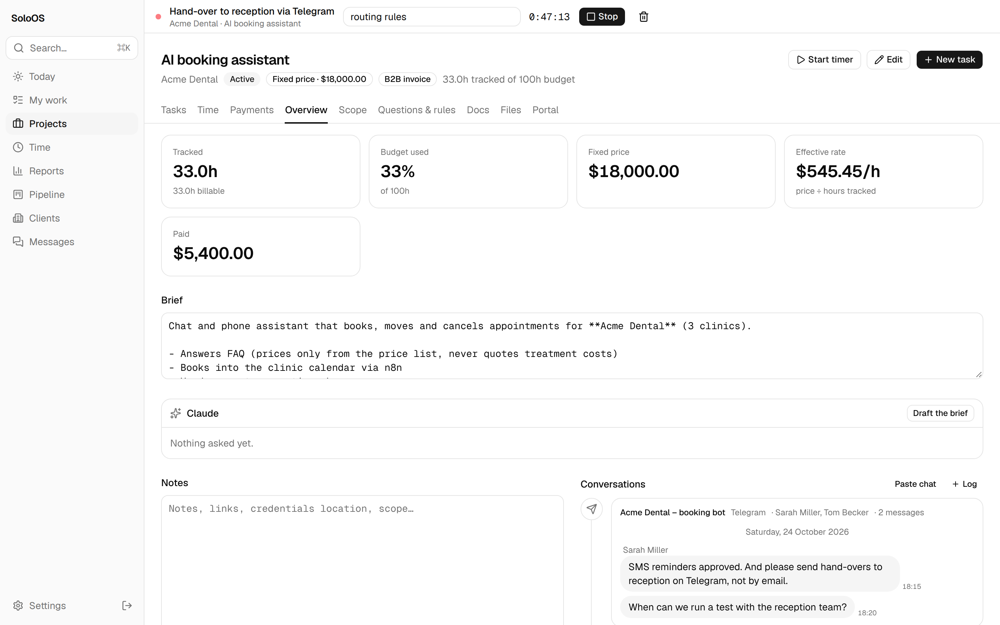</td>
    <td>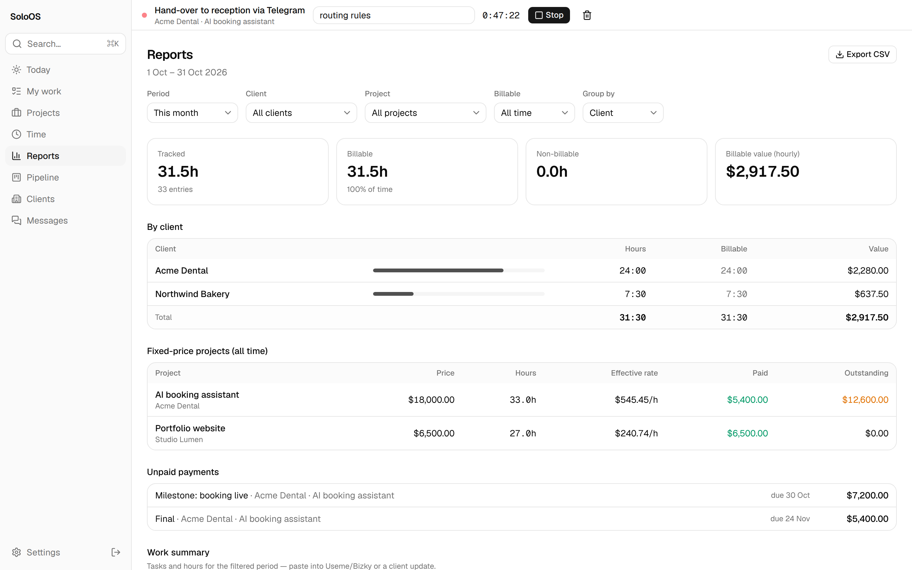</td>
  </tr>
  <tr>
    <td align="center"><sub>Project overview: tracked, budget used, effective rate</sub></td>
    <td align="center"><sub>Reports, fixed-price profitability, unpaid payments</sub></td>
  </tr>
</table>

### Clients: pipeline, timeline, messages

Leads move through a pipeline with a next action and date; overdue follow-ups show up on Today. Each client has a
timeline that interleaves chats, emails, calls and project events.

<table>
  <tr>
    <td>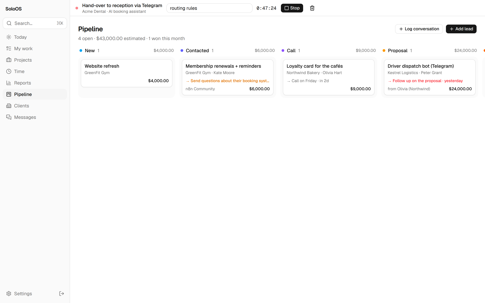</td>
    <td>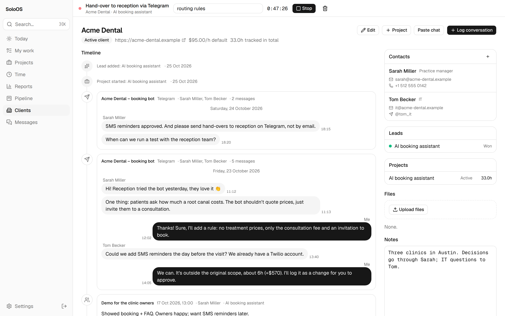</td>
  </tr>
  <tr>
    <td align="center"><sub>Pipeline</sub></td>
    <td align="center"><sub>Client timeline</sub></td>
  </tr>
</table>

Conversations come in from email (IMAP), Telegram exports, or by pasting a chat: WhatsApp, Telegram and Messenger
copies are split into messages automatically, and you fix anything on screen before saving.

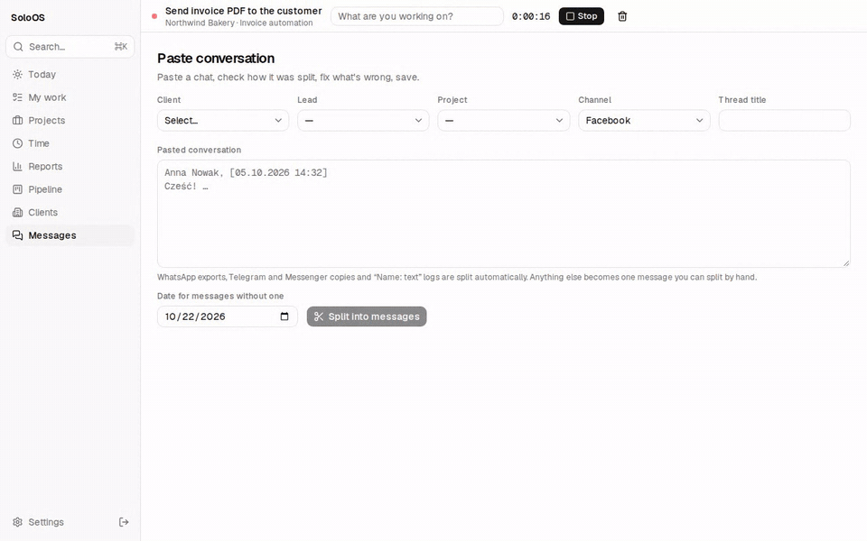

### Scope that holds: decisions, change requests, rules, docs

Baseline the agreed scope; every change request carries its hours and price impact and waits for approval. Decisions
are logged with who made them and the message they came from. Business rules and open questions keep the
"what did we agree?" out of your head, and doc pages (Markdown + Mermaid, with revision history) hold the rest.

<table>
  <tr>
    <td>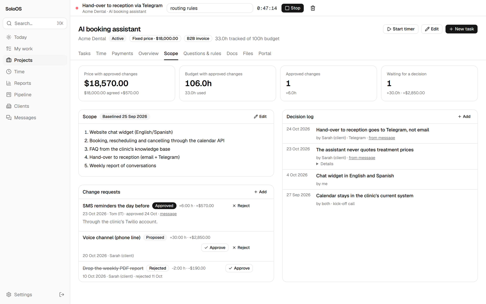</td>
    <td>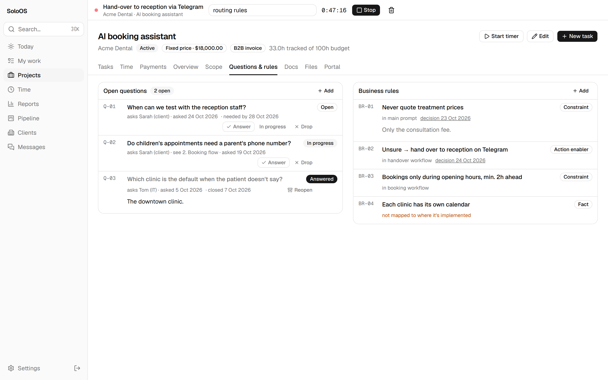</td>
  </tr>
  <tr>
    <td align="center"><sub>Scope, change requests with price impact, decision log</sub></td>
    <td align="center"><sub>Open questions and business rules</sub></td>
  </tr>
  <tr>
    <td colspan="2">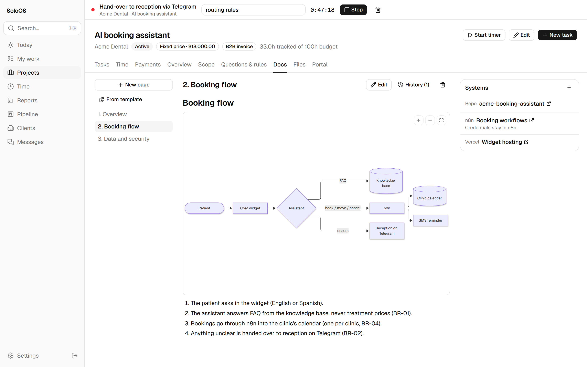</td>
  </tr>
  <tr>
    <td colspan="2" align="center"><sub>Docs with Mermaid diagrams, and links to the systems the project runs on (never credentials)</sub></td>
  </tr>
</table>

### Claude in the app

On a thread, "Summarize & extract" turns a conversation into a summary, decisions, scope changes, tasks, open
questions and a reply draft. Nothing is applied automatically: you log, propose, create or copy each item.
SoloOS is also an MCP server, so Claude (claude.ai, Desktop, mobile, Claude Code) can read and update it.

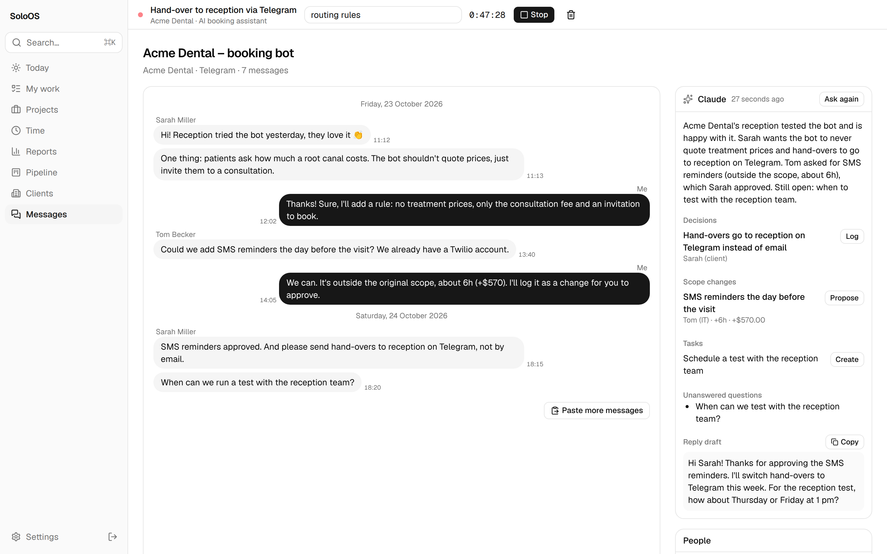

### Client portal

A read-only link per project for the client, in English or Polish: progress, published updates, selected doc pages, the decision
log and an optional hours report, plus a PDF export. It never shows rates, notes or messages.

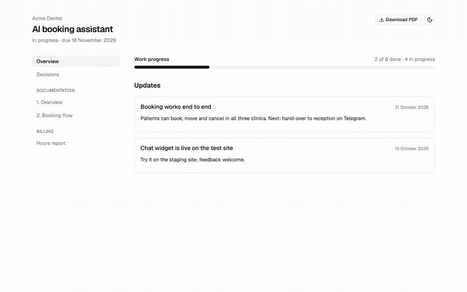

## Stack

Next.js 16 (App Router, server actions) · React 19 · Tailwind 4 + shadcn/ui (Base UI) · Postgres 17 · Drizzle ORM

## Setup

```bash
brew install node pnpm postgresql@17
brew services start postgresql@17
createdb soloos

cp .env.example .env        # set DATABASE_URL (e.g. postgres://$USER@localhost:5432/soloos)
pnpm install
pnpm db:migrate
pnpm db:seed                # "Personal" internal client + SoloOS project
pnpm dev                    # http://127.0.0.1:3000
```

The dev server binds to `127.0.0.1` and runs without a password. Set `APP_PASSWORD` to require a login (always required in production).

## Scripts

| Script | What it does |
|---|---|
| `pnpm dev` | Dev server on 127.0.0.1:3000 |
| `pnpm typecheck` | Generate route types + `tsc` |
| `pnpm db:generate` | Create a migration from `src/db/schema.ts` changes |
| `pnpm db:migrate` | Apply migrations |
| `pnpm db:studio` | Drizzle Studio (DB browser) |
| `pnpm db:seed` | Seed base data (idempotent) |
| `pnpm test` | Unit + integration tests (Vitest, against the `soloos_test` database) |
| `pnpm test:e2e` | Browser tests (Playwright, production build on :3100 against `soloos_e2e`) |
| `pnpm demo:seed` / `pnpm demo:media` | Demo data and the README screenshots/GIFs (see below) |

## Demo data and README media

```bash
createdb soloos_demo
export DATABASE_URL=postgres://127.0.0.1:5432/soloos_demo   # the seed refuses databases without "demo" in the name
pnpm db:migrate && pnpm demo:seed                           # wipes it, then adds made-up clients, projects, time, chats
NEXT_DIST_DIR=.next-demo APP_PASSWORD=demo-password AI_PROVIDER=runner AI_RUNNER_TOKEN=demo-runner-token-0123456789abcdef \
  sh -c 'pnpm build && pnpm exec next start -H 127.0.0.1 -p 3200'
# in another terminal; needs ffmpeg for the GIFs
pnpm demo:seed && FFMPEG=$(which ffmpeg) pnpm demo:media    # writes docs/media/*.png and *.gif
```

The GIFs change the demo data (start a timer, move a task, save a chat), so run `pnpm demo:seed` before each run.

## Tests

- `pnpm test` runs pure unit tests (`src/**/*.test.ts`) and integration tests (`test/integration/`) that call
  server actions and queries against a real Postgres. The database comes from `TEST_DATABASE_URL`
  (default `postgres://127.0.0.1:5432/soloos_test`); it's created and migrated automatically and truncated
  before each test, so the name must contain "test".
- `pnpm test:e2e` builds the app into `.next-e2e`, serves it on port 3100 with `APP_PASSWORD=e2e-password`,
  and drives it with Chromium. The `soloos_e2e` database (`E2E_DATABASE_URL`) is dropped and re-migrated on
  every run. First time: `pnpm exec playwright install chromium` (add `--with-deps` on Linux).
  The flow tests in `e2e/flows.spec.ts` build on each other and run in order.

GitHub Actions runs all of the above on every pull request (`.github/workflows/ci.yml`), with its own Postgres.

## Deploying (Vercel + Neon)

- Production is the `main` branch on Vercel, with a Neon Postgres database (Frankfurt) connected through Vercel's Storage integration.
  The integration sets `DATABASE_URL` (pooled) and `DATABASE_URL_UNPOOLED` (direct, used for migrations).
- Required env var: `APP_PASSWORD`. Optional: `APP_TIMEZONE` (default `Europe/Warsaw`), `NEXT_PUBLIC_OFERTOWNIK_URL`,
  `MCP_TOKEN` (static token for Claude Code), `APP_URL` (public URL, if the forwarded host headers aren't right).
- `vercel.json` pins functions to `fra1` (next to the database) and builds with `scripts/vercel-build.sh`,
  which runs `pnpm db:migrate` on production deploys only. Preview deploys never touch the schema.
- Dev and prod are separate databases: develop against local Postgres, ship schema changes as migration files.
- Back up the production database yourself (e.g. a scheduled `pg_dump`); Neon's point-in-time restore only covers a short window.

## Importing history

Settings → Import: Clockify detailed-report CSV (time entries) and Linear CSV (issues → tasks).
Preview first; re-importing the same file skips rows already imported.

## Messages

Conversations live in threads (one per email thread / chat) with participants mapped to contacts; client, lead and
project timelines show them interleaved with logged conversations.

- **Paste:** Messages → Paste conversation (or "Paste chat" on a client/lead/project). WhatsApp exports, Telegram
  and Messenger copies and "Name: text" logs are split automatically; fix anything on screen before saving.
  Logged conversations have a ✂ button to convert them the same way.
- **Telegram:** Settings → Telegram chats, upload `result.json` from Telegram Desktop's JSON export.
- **Email (IMAP):** set `IMAP_HOST` (e.g. `imap.example.com`), `IMAP_USER`, `IMAP_PASSWORD`, optionally
  `IMAP_MAILBOXES` (default `INBOX,INBOX.Sent`), `EMAIL_ME_ADDRESSES` (other addresses that are you) and
  `IMAP_SINCE_DAYS` (first sync window, default 30). Only mail to/from a contact's email address is kept, replies are
  threaded by Message-ID and nothing is imported twice. Run it from Settings → Email → Sync now, or on a schedule:
  `GET /api/cron/email-sync` with `Authorization: Bearer $CRON_SECRET` (set `CRON_SECRET`, 16+ chars).
  Vercel Cron sends that header itself; add `"crons": [{ "path": "/api/cron/email-sync", "schedule": "*/15 * * * *" }]`
  to `vercel.json` on a plan that allows sub-daily crons (Hobby allows one run a day), or call it from any scheduler.

## Claude in the app

Buttons on a thread ("Summarize & extract": summary, decisions, scope changes, tasks, open questions, reply draft),
on the project overview ("Draft the brief") and on a lead ("Draft a reply"). Claude only suggests; you log, propose,
create or copy each item yourself. Two ways to run it (`AI_PROVIDER`):

- `api` (default when `ANTHROPIC_API_KEY` is set): calls the Anthropic API directly, model `claude-opus-5-5`
  (override with `AI_MODEL`), structured outputs, server-side fallback when a request is declined.
- `runner`: jobs are queued and a machine of yours runs them through your own Claude Code CLI (your subscription).
  Set `AI_RUNNER_TOKEN` (24+ chars) on the server and on that machine, then run
  `SOLOOS_URL=https://<your-domain> AI_RUNNER_TOKEN=… pnpm ai:runner` there (keep it alive with launchd/systemd/tmux).
  The CLI runs with no tools and no MCP servers in an empty temp directory, since prompts contain client messages.

## Client portal

Project → Portal → Turn on gives a read-only link (`/p/<token>`) for the client: updates you publish and doc pages you
tick (always their latest version, diagrams zoomable), plus optional task progress, decision log and hours report
(hours, value and payments). "Download PDF" exports the docs. It never shows notes, messages or internal pages.
"Client language" switches the portal between English and Polish. "New link" replaces a leaked link; "Turn off"
disables it.

## Claude (MCP)

SoloOS is an MCP server at `/api/mcp` (Streamable HTTP), so Claude can read and update it: search, client and
project context, recent messages, importing chats (e.g. transcribed from a screenshot), the project brief,
decision log, change requests (proposed only, you approve them), doc pages with Mermaid diagrams, and tasks.
It can't delete anything, and it refuses credentials like the rest of the app.

- **Claude.ai / Claude mobile / Claude Desktop:** Settings → Connectors → Add custom connector →
  `https://<your-domain>/api/mcp`. You'll be sent to SoloOS to log in and approve. Uses OAuth (dynamic client
  registration + PKCE); tokens are signed with `APP_PASSWORD`, so changing the password disconnects every app.
- **Claude Code:** set `MCP_TOKEN` (32+ random characters, e.g. `openssl rand -hex 32`) in the environment, then
  `claude mcp add --transport http soloos https://<your-domain>/api/mcp --header "Authorization: Bearer <MCP_TOKEN>"`.
  Locally without `APP_PASSWORD` the endpoint is open: `claude mcp add --transport http soloos http://127.0.0.1:3000/api/mcp`.

## Keyboard

- `⌘K` — command palette: jump anywhere, start a timer on any project/task, create task/project, log time
- `⌥S` — stop the running timer, or resume the last one

Set `NEXT_PUBLIC_OFERTOWNIK_URL` in `.env` to turn proposal slugs on leads into links.

## Layout

```
src/db/schema.ts        tables, enums, relations
src/server/actions.ts   PM/time mutations (server actions); crm-, message-, doc-actions.ts for the rest
src/server/queries.ts   reads; crm-, message-, doc-queries.ts alongside
src/server/mcp/         MCP server (tools) and the OAuth pieces for Claude connectors
src/lib/                formatting, labels, billing rules
src/components/app/     app components (timer, board, forms, …)
src/components/ui/      shadcn primitives
src/app/(app)/          pages
```
